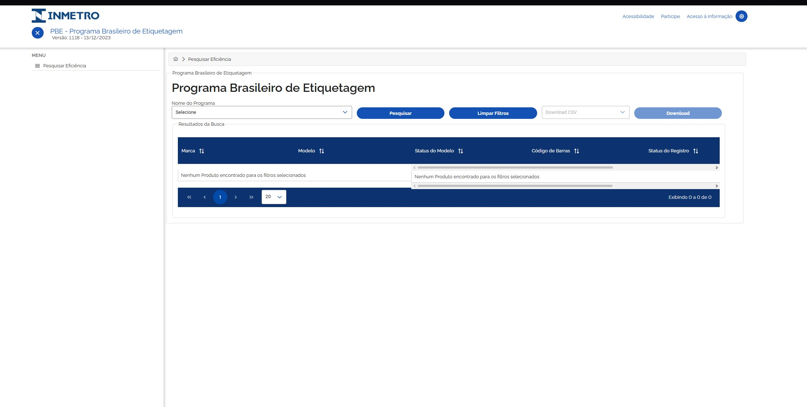
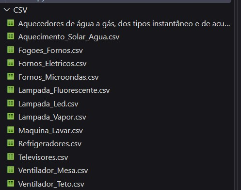
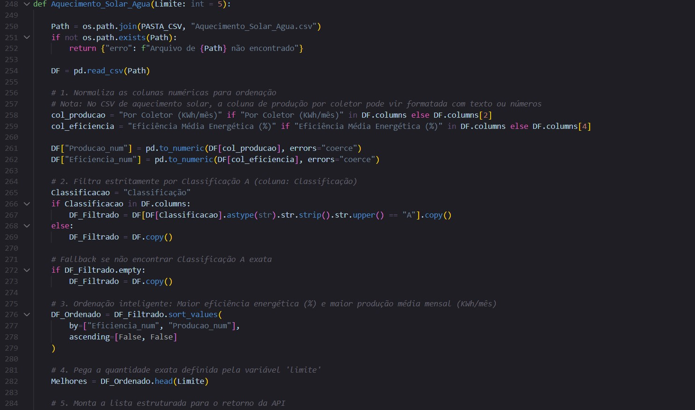
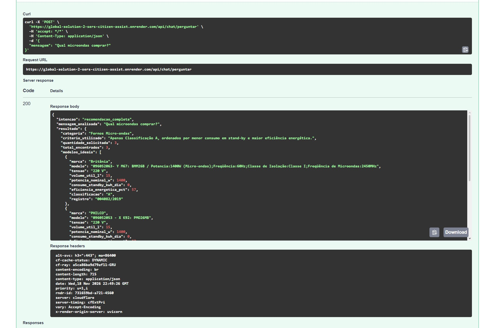
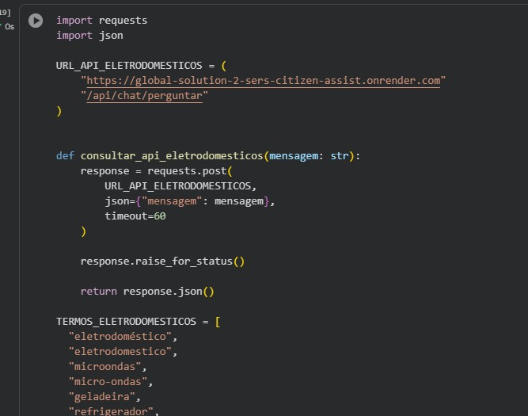

# Citizen Assist AI - Energia API ⚡🤖

API backend desenvolvida em **FastAPI** para fornecer orientações de eficiência energética e recomendações inteligentes de eletrodomésticos com base nos dados oficiais do **PBE Inmetro**. O sistema utiliza uma arquitetura modular baseada em intenções e processamento de arquivos locais, eliminando dependências de web scraping em tempo de execução.

---

## 🚀 Funcionalidades

* **Consulta Local Otimizada:** Leitura e filtragem de datasets do Inmetro via Pandas de forma rápida e segura.
* **Dispatcher por Intenção:** Roteamento inteligente de requisições de linguagem natural para análise específica de cada categoria de aparelho (geladeiras, micro-ondas, TVs, etc.).
* **Documentação Interativa:** Swagger UI integrado (`/docs`) para testes e homologação rápida.

---

## 🛠️ Tecnologias Utilizadas

* **Python 3.11+**
* **FastAPI** (Framework web assíncrono)
* **Uvicorn** (Servidor ASGI)
* **Pandas** (Manipulação e análise de dados tabulares)
* **Pydantic** (Validação de dados e tipagem)
* **Render.com** (Plataforma de deploy em nuvem)

---

## Fonte Utilizada
A lógica da API Funciona com base no [PBE (Programa Brasileiro de Etiquetagem)](https://pbe.inmetro.gov.br/#/programas), programa coordenado pelo Inmetro que avalia e informa o desempenho de produtos e edificações—com foco especial em <b>eficiência energética</b>, ruído e consumo—por meio de etiquetas.



<br>

### Dados Extraídos/Utilizados

Baixamos os dados de classificação, benchmark e desempenho para diversos modelos e tipos de eletrodomésticos utilizados pelo população Brasileira cotidianamente. Os dados brutos (baixados em CSV) encontram-se em /CSV:



<br>

## Lógica e Funções Energéticas

A primeira métrica é a filtragem por produtos de categoria A segundo a avaliação do sistema Imetro, o que já garante ao usuário:

* | <b>Menor consumo na conta de luz ou combustível:</b> Um aparelho categoria A utiliza menos eletricidade (em kWh) ou combustível (em km/l) para realizar a mesma função que modelos de faixas inferiores (B a G).
* | <b>Retorno financeiro a longo prazo:</b> Embora o preço de compra inicial possa ser um pouco maior, a economia mensal na fatura de energia costuma compensar a diferença ao longo da vida útil do equipamento.
* | <b>Desempenho comprovado em laboratório:</b> A classificação não é autodeclarada; ela exige testes padronizados que comprovam que o produto cumpre critérios rígidos de rendimento mínimo.

### Adicional

Além disso, no arquivo app/funcoes.py contamos com funções adicionais para escolher os melhores produtos de cada categoria (lampadas, microondas e etc). O cálculo é feito com base nos princípios de eficiência energética e adaptado para as variáveis de cada Dataframe



***Com isso, o usuário garante opções com a melhor eficiência energética possível logo no processo de compra do produto***

## API, Integração e Funcionamento

<b>A API está pública e pode ser acessada pelo link:</b> https://global-solution-2-sers-citizen-assist.onrender.com

Faça requisições no endpoint: /api/chat/perguntar para testas os resultados 



###<b>Integração ao Chatbot</b>

A integração é simples e pode ser feita utilizando requisições na API e adaptando a resposta ao ChatBot



### Acesse o vídeo anexado no final do arquivo para ver a integração em tempo real com o chatbot desenvolvido

## Limitações

* Não conseguimos implementar uma ferramenta de webscrapping (de modo eficiente) para devolver ao usuário o preço médio dos produtos
* Somos restringidos aos elétrodomésticos cadastros na base
* Os arquivos (CSV e DataFrames) não são atualizados periodicamente. O que significa que novos modelos podem não estar incluidos 

## 📂 Estrutura do Projeto

```text
.
├── app/
│   ├── __init__.py
│   ├── chatbot.py
│   ├── funcoes.py
│   └── main.py
├── CSV/                 # Datasets oficiais do PBE Inmetro
├── requirements.txt     # Dependências do projeto
├── runtime.txt          # Versão do Python configurada para o ambiente
└── README.md
```

## 🧪 Como Executar Localmente

1. Clone o repositório:

   **Bash**

   ```bash
   git clone https://github.com/Temitope-Ogunbanjo/GS_2_SERS.git
   cd GS_2_SERS
   ```

2. Crie e ative um ambiente virtual:

   **Bash**

   ```bash
   python -m venv .venv

   # No Windows:
   .venv\Scripts\activate

   # No Linux/Mac:
   source .venv/bin/activate
   ```

3. Instale as dependências:

   ```bash
   pip install -r requirements.txt
   ```

4. Inicie o servidor localmente com Uvicorn:

   ```bash
   uvicorn app.main:App --reload
   ```

5. Acesse a documentação interativa em:

   `http://127.0.0.1:8000/docs`

## 👥 Equipe de Desenvolvimento

- **Gabriel Oliveira Gusmão Florêncio dos Santos** — RM 573747
- **Gustavo de Souza Abreu** — RM 574080
- **Temitope Kuku da Silva Ogunbanjo** — RM 573772

***[Clique aqui para acessar o vídeo explicativo e demonstrativo no youtube](https://youtu.be/I4uxKGNxGjc?si=hhS7Dvmrrg4sGbem)***
